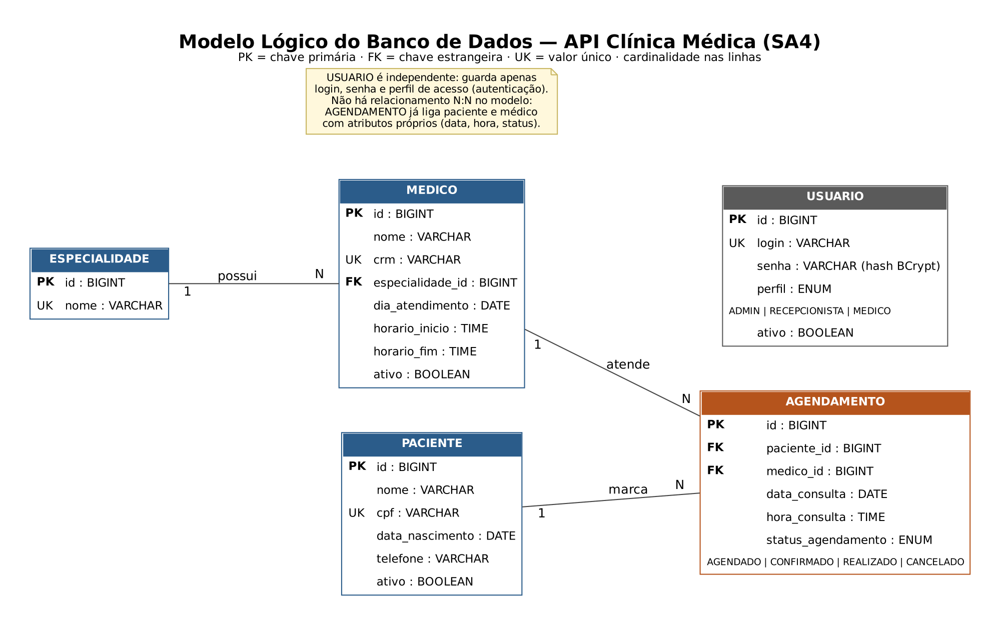

# 🏥 API — Sistema de Gestão de Clínica Médica

**SENAI · Desenvolvimento de Sistemas · SA4 – Etapa 2**
Professor: Caio Luiz Mota Barreto

## 1. Objetivo do projeto

A recepção da clínica não tinha uma visão centralizada da agenda médica. Isso causava **marcações duplicadas** e dificuldade de encontrar horários livres.

Esta API REST é a **fonte única de verdade** para as consultas da clínica. Ela permite:

- cadastrar pacientes, médicos e especialidades;
- consultar horários livres e agendar consultas, com **bloqueio automático de conflitos**;
- confirmar, realizar, cancelar e reagendar consultas;
- controlar o acesso por perfil (Administrador, Recepcionista e Médico), com login via JWT.

**Equipe**

| Integrante |
|---|
| Beatriz Falheiro |
| Elen Santos |
| Miguel Dias |
| Monique Silva |

---

## 2. Tecnologias utilizadas

| Tecnologia | Uso no projeto |
|---|---|
| **Java 21** | Linguagem |
| **Spring Boot 4.1** | Base da aplicação (configuração automática e servidor embutido) |
| **Spring Web MVC** | API REST (controllers, JSON, códigos HTTP) |
| **Spring Data JPA + Hibernate** | Persistência e mapeamento objeto-relacional |
| **H2 Database** | Banco relacional em memória |
| **Bean Validation** | Validação dos DTOs (`@NotBlank`, `@Pattern`, `@Past`...) |
| **Spring Security + JWT (auth0 java-jwt)** | Autenticação e autorização por perfil |
| **BCrypt** | Criptografia (hash) das senhas |
| **Maven** | Gerenciamento de dependências e build |
| **Postman** | Testes dos endpoints |

## 3. Como executar

**Pré-requisito:** JDK 21. O Maven não precisa ser instalado, porque o projeto traz o `mvnw`.

**Pelo IntelliJ IDEA**
1. Clique em *Open* e selecione a pasta do projeto (a que contém o `pom.xml`).
2. Aguarde o Maven baixar as dependências.
3. Configure o SDK do projeto como Java 21.
4. Abra `ClinicaApiApplication.java` e clique no ▶ verde.

**Pelo terminal**
```bash
./mvnw spring-boot:run        # Linux/Mac
mvnw.cmd spring-boot:run      # Windows
```

A API sobe em **http://localhost:8080**. Ao iniciar, ela cria automaticamente um usuário **ADMIN** (veja a seção 8).

### Variáveis de ambiente (opcional)

Nenhum segredo real fica no repositório. Em produção, defina:

| Variável | Para que serve | Valor padrão (só desenvolvimento) |
|---|---|---|
| `JWT_SECRET` | Chave de assinatura do token JWT | `chave-dev-clinica-trocar-em-producao` |
| `ADMIN_LOGIN` | Login do administrador inicial | `admin` |
| `ADMIN_SENHA` | Senha do administrador inicial | `admin123` |

## 4. Banco de dados (H2)

Configuração em `src/main/resources/application.properties`:

```properties
spring.datasource.url=jdbc:h2:mem:clinica_api_db
spring.datasource.username=sa
spring.datasource.password=
spring.jpa.hibernate.ddl-auto=create-drop
spring.h2.console.enabled=true
spring.h2.console.path=/h2-console
```

- As tabelas são criadas automaticamente pelo Hibernate a partir das entidades.
- **Console web:** http://localhost:8080/h2-console
  - JDBC URL: `jdbc:h2:mem:clinica_api_db`
  - Usuário: `sa`
  - Senha: em branco
- O diagrama do banco está em [`docs/Diagrama_Banco_de_Dados.png`](docs/Diagrama_Banco_de_Dados.png).

## 5. Entidades e relacionamentos



| Entidade | Principais atributos | Restrições |
|---|---|---|
| **Especialidade** | id, nome | `nome` único |
| **Medico** | id, nome, crm, especialidade_id, dia_atendimento, horario_inicio, horario_fim, ativo | `crm` único; FK obrigatória para Especialidade |
| **Paciente** | id, nome, cpf, data_nascimento, telefone, ativo | `cpf` único |
| **Agendamento** | id, paciente_id, medico_id, data_consulta, hora_consulta, status_agendamento | FKs obrigatórias para Paciente e Médico |
| **Usuario** | id, login, senha (hash), perfil, ativo | `login` único |

**Relacionamentos (1:N / N:1, com `@ManyToOne`)**
- **Especialidade 1 : N Médico:** uma especialidade tem vários médicos, e cada médico pertence a uma especialidade.
- **Médico 1 : N Agendamento:** um médico atende várias consultas.
- **Paciente 1 : N Agendamento:** um paciente pode ter várias consultas.
- **Usuario** é independente. Guarda só as credenciais e o perfil de acesso.

**Por que não há relacionamento N:N (item 3.5)?** Paciente e Médico se relacionam "muitos para muitos" na prática: um paciente consulta vários médicos, e um médico atende vários pacientes. Só que essa associação tem **atributos próprios**: data, hora e status. Por isso ela foi modelada como a **entidade intermediária `Agendamento`**, com dois relacionamentos N:1, e não com `@ManyToMany`, que não guardaria esses dados. Também não existe outra associação N:N real no MVP. Cada médico tem uma única especialidade, conforme o planejamento da Etapa 1.

**Enums**
- `StatusAgendamento`: AGENDADO, CONFIRMADO, REALIZADO, CANCELADO
- `Perfil`: ADMIN, RECEPCIONISTA, MEDICO

## 6. Regras de negócio implementadas

Todas as regras ficam na camada **Service**.

**Agendamento**
1. **Conflito de horário:** um médico não pode ter duas consultas ativas no mesmo dia e horário (**409**). Consultas canceladas não bloqueiam o horário.
2. **Conflito do paciente:** o paciente não pode ter duas consultas no mesmo dia e horário (**409**).
3. **Funcionamento da clínica:** de segunda a sábado, das 07:00 às 19:00. A última consulta começa às 18:30. Domingo ou fora do horário retorna **400**.
4. **Consultas de 30 minutos:** só são aceitos horários cheios ou de meia hora (08:00, 08:30...).
5. **Jornada do médico:** a consulta precisa caber entre `horarioInicio` e `horarioFim` do médico.
6. **Sem datas passadas:** não é possível agendar no passado.
7. **Médico ou paciente inativo** não pode receber agendamento.

**Ciclo de status**
8. Todo agendamento nasce como **AGENDADO**. A recepção pode **confirmar**, e o médico registra como **REALIZADO**.
9. Uma consulta não pode ser marcada como realizada se for de data futura.
10. **Cancelar** só vale para consultas AGENDADAS ou CONFIRMADAS. Consulta já realizada ou cancelada não pode ser alterada (**409**).
11. **Reagendamento transacional (`@Transactional`):** cancela a consulta atual e cria a nova **na mesma transação**. Se o novo horário for inválido, a exceção provoca **rollback** e a consulta original continua AGENDADA. Esse cenário é demonstrado na coleção do Postman.

**Cadastros**
12. CPF, CRM, login e nome de especialidade são únicos (**409**).
13. A jornada do médico precisa estar dentro do funcionamento da clínica, com início antes do fim.
14. Uma especialidade com médicos vinculados não pode ser excluída (**409**).
15. Paciente e médico são **inativados** (exclusão lógica), não apagados, para preservar o histórico de consultas.
16. **Inativação de usuários:** só usuários com perfil RECEPCIONISTA podem ser inativados. Um usuário inativo não consegue fazer login, e os tokens antigos dele deixam de valer.

## 7. Endpoints

Todos exigem `Authorization: Bearer <token>`, exceto `POST /login`.

| Método | Rota | Descrição | Perfis |
|---|---|---|---|
| POST | `/login` | Autentica e devolve o JWT | público |
| GET | `/usuario` · `/usuario/{id}` · `/usuario/ativos` · `/usuario/perfil/{perfil}` | Consultar usuários | ADMIN |
| POST | `/usuario` | Cadastrar usuário | ADMIN |
| PATCH | `/usuario/{id}/senha` · `/usuario/{id}/inativar` | Trocar senha / inativar | ADMIN |
| GET | `/especialidade` · `/especialidade/{id}` | Consultar especialidades | todos |
| POST · PUT · DELETE | `/especialidade` · `/especialidade/{id}` | Cadastrar / atualizar / excluir | ADMIN |
| GET | `/medico` · `/medico/{id}` · `/medico/especialidade/{id}` | Consultar médicos | todos |
| POST · PUT · PATCH | `/medico` · `/medico/{id}` · `/medico/{id}/inativar` | Cadastrar / atualizar / inativar | ADMIN |
| GET | `/pacientes` · `/pacientes/{id}` | Consultar pacientes | ADMIN, RECEPCIONISTA |
| POST · PUT · PATCH | `/pacientes` · `/pacientes/{id}` · `/pacientes/{id}/inativar` | Cadastrar / atualizar / inativar | ADMIN, RECEPCIONISTA |
| GET | `/agendamento` · `/agendamento/{id}` · `/agendamento/status/{status}` · `/agendamento/data/{data}` · `/agendamento/hora/{hora}` | Consultar agendamentos | todos |
| GET | `/agendamento/horarios-livres?medicoId=1&data=2026-12-07` | Horários livres do médico (RF04) | todos |
| GET | `/agendamento/medico/{medicoId}?data=2026-12-07` | Agenda do médico no dia (RF05) | todos |
| POST | `/agendamento` | Agendar consulta (RF03) | ADMIN, RECEPCIONISTA |
| PATCH | `/agendamento/{id}/confirmar` | Confirmar presença (RF06) | ADMIN, RECEPCIONISTA |
| PATCH | `/agendamento/{id}/cancelar` | Cancelar e liberar o horário (RF07) | ADMIN, RECEPCIONISTA |
| PATCH | `/agendamento/{id}/reagendar` | Reagendar, de forma transacional (RF07) | ADMIN, RECEPCIONISTA |
| PATCH | `/agendamento/{id}/realizar` | Registrar atendimento (RF06) | ADMIN, MEDICO |

Listagens são paginadas, com 10 itens por página. Exemplo: `/pacientes?page=0&size=5&sort=nome`.

### Exemplos de requisição e resposta

**Login**: `POST /login`
```json
{ "login": "admin", "senha": "admin123" }
```
```json
{ "token": "eyJhbGciOiJIUzI1NiIsInR5cCI6IkpXVCJ9..." }
```

**Cadastrar paciente**: `POST /pacientes` → `201 Created`
```json
{ "nome": "Maria Souza", "dataNascimento": "1990-05-10", "telefone": "71999998888", "cpf": "12345678901" }
```
```json
{ "id": 1, "nome": "Maria Souza", "dataNascimento": "1990-05-10", "telefone": "71999998888", "cpf": "12345678901", "ativo": true }
```

**Cadastrar médico**: `POST /medico` → `201 Created`
```json
{ "nome": "Dr. João Silva", "crm": "123456-BA", "especialidadeId": 1,
  "diaAtendimento": "2026-12-07", "horarioInicio": "08:00", "horarioFim": "12:00" }
```

**Agendar consulta**: `POST /agendamento` → `201 Created`
```json
{ "pacienteId": 1, "medicoId": 1, "dataConsulta": "2026-12-07", "horaConsulta": "09:00" }
```
```json
{ "id": 1, "pacienteId": 1, "paciente": "Maria Souza", "medicoId": 1, "medico": "Dr. João Silva",
  "especialidade": "Cardiologia", "dataConsulta": "2026-12-07", "horaConsulta": "09:00:00", "status": "AGENDADO" }
```

**Reagendar**: `PATCH /agendamento/1/reagendar`
```json
{ "novaData": "2026-12-07", "novaHora": "11:00" }
```

**Horários livres**: `GET /agendamento/horarios-livres?medicoId=1&data=2026-12-07`
```json
["08:00:00", "08:30:00", "09:30:00", "10:00:00", "10:30:00", "11:00:00", "11:30:00"]
```

### Padrão de erro

Todo erro segue o mesmo formato JSON:
```json
{
  "status": 409,
  "erro": "Conflict",
  "mensagem": "O médico já possui consulta marcada neste dia e horário.",
  "dataHora": "2026-11-22T15:51:04.21",
  "caminho": "/agendamento",
  "campos": null
}
```
Nos erros de validação (400), `campos` lista cada problema, por exemplo `["cpf: O CPF deve conter exatamente 11 dígitos numéricos."]`.

| Código | Quando acontece |
|---|---|
| 200 / 201 / 204 | Sucesso / recurso criado / exclusão sem corpo |
| 400 | Campos inválidos, JSON mal formatado ou regra de negócio violada (ex.: domingo) |
| 401 | Sem token, token inválido ou expirado, login errado ou usuário inativo |
| 403 | Usuário autenticado, mas o perfil não tem permissão |
| 404 | Registro não encontrado |
| 409 | Conflito: horário ocupado, dado duplicado ou status que não permite a ação |
| 500 | Erro inesperado |

## 8. Autenticação e perfis

1. Ao iniciar, a API cria o usuário **`admin` / `admin123`** (perfil ADMIN).
2. Faça `POST /login` com esse login e senha. A resposta traz o **token JWT**, válido por **2 horas**.
3. Envie o token em todas as requisições:
   `Authorization: Bearer <token>`
   No Postman, use a aba *Authorization*, tipo *Bearer Token*.
4. Com o token de ADMIN, cadastre os outros usuários em `POST /usuario`:
   ```json
   { "login": "recep", "senha": "recep123", "perfil": "RECEPCIONISTA" }
   ```

| Perfil | O que pode fazer |
|---|---|
| **ADMIN** | Tudo: usuários, especialidades, médicos, pacientes e agendamentos |
| **RECEPCIONISTA** | Pacientes; agendar, confirmar, cancelar e reagendar; consultar médicos e agenda |
| **MEDICO** | Consultar médicos, agenda e agendamentos; marcar consulta como **realizada** |

As senhas são guardadas com hash **BCrypt** e nunca aparecem nas respostas.

## 9. Testes (Postman)

A coleção fica em [`docs/Clinica-API.postman_collection.json`](docs/Clinica-API.postman_collection.json). São **68 requisições, com testes automáticos**, divididas em 8 pastas:

1. Autenticação
2. Usuários
3. Especialidades
4. Médicos
5. Pacientes
6. Fluxo completo de agendamento, incluindo o **rollback**
7. Regras de negócio e validações (400, 404, 409)
8. Segurança (401 e 403)

**Como usar**
1. Inicie a API.
2. No Postman, clique em *Import* e escolha o arquivo `.json`.
3. Clique com o botão direito na coleção, depois em *Run collection* e *Run*.

**Sem Postman?** O arquivo [`docs/Exemplos_de_Requisicoes_JSON.md`](docs/Exemplos_de_Requisicoes_JSON.md) traz as mesmas 68 requisições, com o JSON pronto para copiar e colar, o endereço, o token necessário e a resposta esperada.

Os tokens, os IDs e as datas (sempre uma segunda-feira futura) são preenchidos automaticamente. Para rodar a coleção de novo, **reinicie a API**, porque o H2 apaga os dados ao desligar.

## 10. Limitações conhecidas

- **Banco H2 em memória:** os dados são apagados toda vez que a aplicação é desligada.
- **Sem refresh token:** o JWT expira em 2 horas e é preciso fazer login de novo (não exigido no enunciado).
- **Jornada do médico simplificada:** um horário de início e fim únicos. O campo `diaAtendimento` é informativo, e não existe grade semanal com dias diferentes.
- **Duração fixa** de 30 minutos por consulta.
- **Concorrência:** o conflito é validado no Service, dentro de uma transação. Em um cenário de altíssima concorrência, o ideal seria também uma restrição única no banco ou um *lock* (RNF04).
- **Sem vínculo entre o usuário MEDICO e o cadastro de Médico:** um médico logado consegue ver as agendas de todos os médicos, não só a dele.
- **Sem relatório de ocupação (RF08):** é um COULD, previsto para uma versão futura.
- **Sem front-end:** não é exigido nesta etapa.

## 11. Estrutura do projeto

```
src/main/java/br/com/clinica/clinica_api
├── config/       → segurança (SecurityConfigurations, SecurityFilter), tratamento de erros e dados iniciais
├── controller/   → recebe as requisições HTTP e devolve JSON
├── dto/          → objetos de entrada (Request) e saída (Response)
├── enums/        → Perfil e StatusAgendamento
├── exception/    → exceções de negócio (404, 409, 400)
├── model/        → entidades JPA (tabelas)
├── repository/   → acesso ao banco (Spring Data JPA)
└── service/      → regras de negócio e transações
```
